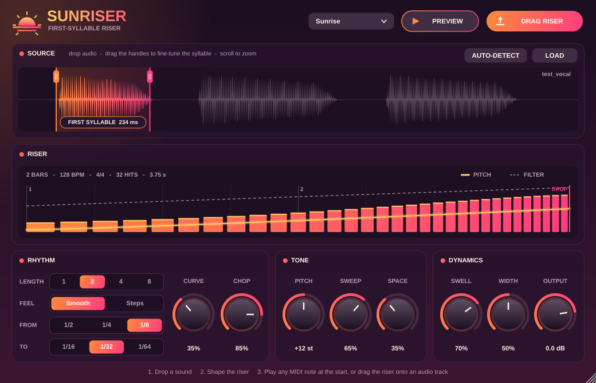

# SunRiser

A first-syllable riser instrument. Drop in a vocal (or any sound). SunRiser finds the first
syllable and builds a tempo-synced riser from it. The riser has accelerating repeats, a pitch rise, a filter
sweep, a growing reverb and a volume swell. It always ends exactly on the drop.

Formats: **VST3** (Ableton Live, FL Studio, Cubase, Studio One, Bitwig, Reaper) and **AU** (Logic Pro,
GarageBand), plus a Standalone app.

## Using it

1. **Load a sound.** Drag an audio file onto the plugin, or click the drop zone / LOAD.
   SunRiser marks the first syllable automatically. Drag the handles to adjust it, drag inside the
   region to move it, double-click (or press AUTO-DETECT) to re-detect, and scroll to zoom.
2. **Shape the riser.** The RISER panel shows every hit: bar height is volume, the bright line is pitch
   and the dashed line is the filter.
3. **Trigger it.** Put a MIDI note (any key) **N bars before your drop**, where N is the LENGTH setting. The riser
   plays as a one-shot and lands on the bar line. You can also press **PREVIEW**.
4. **Or render it.** Drag **DRAG RISER** onto an audio track, or click it to save a 24-bit WAV.

| Control | What it does |
|---|---|
| Length | 1 / 2 / 4 / 8 bars (follows host tempo and time signature) |
| Feel | Smooth = continuous acceleration. Steps = 1/4 > 1/8 > 1/16 snare-roll doubling on the grid |
| From / To | Repeat rate at the start and at the drop |
| Curve | How late the acceleration kicks in |
| Chop | How much of each gap the syllable fills (lower = choppier) |
| Pitch | Pitch rise by the drop (0 to +24 semitones) |
| Sweep | Low-pass opens and high-pass thins the lows into the drop |
| Space | Reverb that builds over the riser |
| Swell | Fade-in from quiet to full |
| Width | Hits ping-pong left/right more as it builds |
| Output | Output level |

Themes: Sunrise, Golden Hour, Dusk, Ocean Dawn, Daylight. The theme is saved with your project. The loaded sound is
saved inside the project as FLAC (max 20 s), so sessions reopen on any machine.

## Building

### Easiest: GitHub Actions (no compiler needed)
Push this folder to a GitHub repository. The included workflow (`.github/workflows/build.yml`) builds:
- **SunRiser-Windows**: `SunRiser.vst3`
- **SunRiser-macOS**: `SunRiser.vst3` + `SunRiser.component` (AU), universal (Apple Silicon + Intel)

Download them from the run's *Artifacts* section (Actions tab).

### Windows (local)
Install Visual Studio 2022 or newer ("Desktop development with C++") and CMake. Then:

    cmake -B build -A x64
    cmake --build build --config Release --target SunRiser_VST3

### macOS (local)
Install Xcode and CMake. Then:

    cmake -B build -G Xcode
    cmake --build build --config Release --target SunRiser_VST3 SunRiser_AU

Output is in `build/SunRiser_artefacts/Release/`.

## Installing

| System | Copy | To |
|---|---|---|
| Windows | `SunRiser.vst3` | `C:\Program Files\Common Files\VST3\` |
| macOS | `SunRiser.vst3` | `/Library/Audio/Plug-Ins/VST3/` |
| macOS | `SunRiser.component` | `/Library/Audio/Plug-Ins/Components/` |

- **Ableton Live:** Settings > Plug-Ins > turn on "Use VST3 Plug-in System Folders" > Rescan. SunRiser is under Plug-ins > VST3.
- **FL Studio:** Options > Manage plugins > Find more plugins, then add SunRiser to the Channel Rack.
- **Logic Pro:** It appears under AU Instruments > MyStudio > SunRiser on a Software Instrument track.

**macOS builds are unsigned.** If macOS blocks the plugin, run this once in Terminal:

    sudo xattr -dr com.apple.quarantine /Library/Audio/Plug-Ins/Components/SunRiser.component /Library/Audio/Plug-Ins/VST3/SunRiser.vst3

**Pro Tools (AAX)** is not included. It needs Avid's AAX SDK and PACE code signing, which require
a free Avid developer account.

## Tests
`cmake -B build -DSUNRISER_BUILD_TESTS=ON` builds `SunRiserTest`. It checks syllable detection,
riser timing, MIDI playback, project save/restore and WAV export, and saves GUI snapshots.
